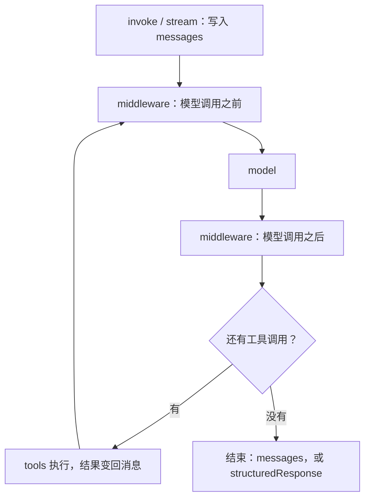

# 按 createAgent 的参数学习

官网的主线是一句话：**Agent = Model + Harness**。Agent 是模型在循环里调用工具，直到任务完成。Harness 是包在循环外面的东西：系统提示、工具，以及在每一步插手的 middleware。`createAgent` 就是这个 harness。

先跑通最小循环，再一次只加一个构造参数。记忆、护栏、人工接入都挂在同一条循环上，依赖前面的 `checkpointer` 和 `middleware`。

```ts
const agent = createAgent({
  model, // 推理引擎
  tools, // 模型可以调用的动作
  systemPrompt, // 写进循环的系统消息
  responseFormat, // 最终要交回的结构化结果
  middleware, // 模型调用和工具调用前后的钩子
  checkpointer, // 同一条对话里的短期记忆
  store, // 跨对话保留的长期记忆
  name, // 嵌进更大图或多智能体时的名字
});

await agent.invoke(
  { messages }, // 这一轮的对话状态
  { configurable: { thread_id } }, // 短期记忆按这条线程读写
);
```

`messages` 在每次 `invoke` / `stream` 时传入。循环会把模型回复和工具结果继续追加进去。`systemPrompt` 是构造时放进这条对话的系统消息。



命令都在仓库根目录执行。`bun run --filter @autix/langchain-docs list` 按下面的顺序打印脚本。

| 顺序 | 参数或入口 | 作用 | 官网 |
| --- | --- | --- | --- |
| 0 | `model` + `tools` | 最小循环能跑起来 | [Quickstart](https://docs.langchain.com/oss/javascript/langchain/quickstart) |
| 1 | `model` | 推理引擎。字符串或 chat model | [Models](https://docs.langchain.com/oss/javascript/langchain/models) |
| 2 | `tools` | 模型可执行的动作，返回值变成 `ToolMessage` | [Tools](https://docs.langchain.com/oss/javascript/langchain/tools) |
| 3 | `messages`、`systemPrompt` | 循环里的对话状态。`systemPrompt` 在构造时写入 | [Messages](https://docs.langchain.com/oss/javascript/langchain/messages)、[Agents](https://docs.langchain.com/oss/javascript/langchain/agents) |
| 4 | `responseFormat` | 结束时交出 `structuredResponse` | [Structured output](https://docs.langchain.com/oss/javascript/langchain/structured-output) |
| 5 | `middleware` | 包住模型调用和工具调用。钩子读的是 state | [Middleware](https://docs.langchain.com/oss/javascript/langchain/middleware/overview) |
| 6 | `checkpointer` | 同一条 `thread_id` 上的短期记忆 | [Short-term memory](https://docs.langchain.com/oss/javascript/langchain/short-term-memory) |
| 7 | `stream` / `streamEvents` | 看见同一次运行的中间步骤。这是调用方式，不是构造参数 | [Streaming](https://docs.langchain.com/oss/javascript/langchain/streaming)、[Event streaming](https://docs.langchain.com/oss/javascript/langchain/event-streaming) |
| 8 | 仍是上面的参数 | 护栏和人工接入是 middleware；长期记忆是 `store`；MCP 更换 `tools` 的来源；`name` 用于多智能体 | 见第 8 节 |

## 0. 最小循环

[Quickstart](https://docs.langchain.com/oss/javascript/langchain/quickstart) 用一个天气工具把循环跑通：`createAgent({ model, tools })`，再 `invoke({ messages })`。模型决定要不要调工具，工具结果回到消息列表，模型再答一句。

后面的 Quickstart 按「真实研究代理」把同一组参数拆开：系统提示、抓取网页的工具、模型配置、`MemorySaver`，最后用 `createAgent` 和 `createDeepAgent` 各跑一次。`createDeepAgent` 是在 `createAgent` 上预先装好文件系统、摘要、子代理等 middleware 的厚 harness。先把薄的 `createAgent` 读懂，再看它多装了什么。

```bash
bun run --filter @autix/langchain-docs quickstart
bun run --filter @autix/langchain-docs quickstart:system-prompt
bun run --filter @autix/langchain-docs quickstart:fetch-text-from-url
bun run --filter @autix/langchain-docs quickstart:model
bun run --filter @autix/langchain-docs quickstart:memory
bun run --filter @autix/langchain-docs quickstart:research-agent
```

## 1. `model`

[Models](https://docs.langchain.com/oss/javascript/langchain/models) 是循环里的推理引擎。`createAgent` 的 `model` 可以是 `"openai:..."` 这种供应商字符串，也可以是已经建好的 chat model。换模型时，工具、消息和 middleware 保持不动。

这一层先脱离 agent，单独看模型能做什么：

- 初始化：`initChatModel`、温度、`maxTokens`、超时和重试。
- 调用：`invoke`、`stream`、`batch`。
- 工具调用：`bindTools` 之后自己写「模型 → 执行工具 → 把 ToolMessage 送回去」的循环。这就是 `createAgent` 替你转的那一圈。
- 结构化输出：`withStructuredOutput`。这是模型自己的能力；agent 上的 `responseFormat` 在第 4 步。
- 进阶：token 用量、调用配置、按条件换模型。多模态和推理内容只在 `model.profile` 声明支持时才跑。

```bash
bun run --filter @autix/langchain-docs models:init
bun run --filter @autix/langchain-docs models:invocation
bun run --filter @autix/langchain-docs models:tool-calling
bun run --filter @autix/langchain-docs models:structured-output
bun run --filter @autix/langchain-docs models:advanced
```

## 2. `tools`

[Tools](https://docs.langchain.com/oss/javascript/langchain/tools) 是模型在循环里能执行的动作。`tool()` 需要名字、描述和 Zod schema。模型只看见这份描述，描述写清楚，它才知道何时调用、传什么参数。

工具的返回值会变成一条 `ToolMessage`，下一轮模型调用读到它。返回形式决定这条消息长什么样，也决定循环是否继续：

| 脚本 | 这一节在看什么 |
| --- | --- |
| `tools:return-string` | 返回字符串，agent 包成 ToolMessage |
| `tools:return-object` | 返回对象，序列化进 ToolMessage |
| `tools:return-multimodal` | 返回图片等内容块。模型 profile 不支持图像输入时会跳过模型调用 |
| `tools:return-command` | 返回 `Command`，同时改 agent state 并写下对应的 ToolMessage |
| `tools:return-direct` | 这一步的工具全部 `returnDirect` 时，循环在工具消息处停下 |
| `tools:context` | 工具里读这次调用的上下文、执行信息，以及自定义流的 `writer` |
| `tools:store` | 工具自己 `put` 进 `store`。`store` 这个参数在第 8 步的长期记忆 |
| `tools:errors` | `wrapToolCall` 把抛出的错误变成 ToolMessage，循环可以继续 |
| `tools:dynamic` | 按 state 或 context 过滤工具，或在运行时注册一个原来不在列表里的工具 |

```bash
bun run --filter @autix/langchain-docs tools:return-string
bun run --filter @autix/langchain-docs tools:return-object
bun run --filter @autix/langchain-docs tools:return-multimodal
bun run --filter @autix/langchain-docs tools:return-command
bun run --filter @autix/langchain-docs tools:return-direct
bun run --filter @autix/langchain-docs tools:context
bun run --filter @autix/langchain-docs tools:store
bun run --filter @autix/langchain-docs tools:errors
bun run --filter @autix/langchain-docs tools:dynamic
```

## 3. `messages` 与 `systemPrompt`

[Messages](https://docs.langchain.com/oss/javascript/langchain/messages) 是循环读写的对话状态。一次模型调用吃进一组消息，吐出一条 AI 消息；一次工具调用再追加一条工具消息。短记忆、裁剪、摘要，处理的都是这份列表。

消息有四类角色：

- `system`：任务说明和约束。`createAgent({ systemPrompt })` 写入的就是它。提示要随用户或状态变化时，改用 middleware 动态生成。
- `human`：用户这一轮的输入，也就是 `invoke` 里的 `messages`。
- `ai`：模型回复，里面可以带工具调用、用量和结束原因。
- `tool`：工具结果，用工具调用 id 对上那条 AI 消息。

内容可以是字符串，也可以是标准内容块（文本、推理、图像）。通知元数据留在 human / tool 消息上，供界面区分「这是人工接入写下的结果」和「这是工具真的执行了」。`toJSON` / `load` 用来保存和恢复消息。

`systemPrompt` 的 agent 示例在 `src/agents/system-prompt.ts`。消息示例直接对模型调用，方便看清对象形状，再放回 agent。

```bash
bun run --filter @autix/langchain-docs messages:basic
bun run --filter @autix/langchain-docs messages:types
bun run --filter @autix/langchain-docs messages:content
bun run --filter @autix/langchain-docs messages:notifications
bun run --filter @autix/langchain-docs messages:serialization
bun run --filter @autix/langchain-docs agents:system-prompt
```

## 4. `responseFormat`

[Structured output](https://docs.langchain.com/oss/javascript/langchain/structured-output) 让循环结束时交出一份校验过的对象，结果在 `result.structuredResponse`。构造参数是 `responseFormat`，可以是 Zod schema、其它 Standard Schema，或 JSON Schema。

这一页是独立章节，和 Models、Agents 里的同名示例不是同一套调用：

| 位置 | 调用 | 结果在哪 |
| --- | --- | --- |
| [Models](https://docs.langchain.com/oss/javascript/langchain/models) | `model.withStructuredOutput` | 模型这次调用的返回值。没有工具循环 |
| [Agents](https://docs.langchain.com/oss/javascript/langchain/agents) | `createAgent({ responseFormat })` | `result.structuredResponse`。模型可以先调别的工具，再交结构 |
| [Structured output](https://docs.langchain.com/oss/javascript/langchain/structured-output) | `providerStrategy` / `toolStrategy`，以及解析失败、refusal、`OutputFixingParser` | 策略和错误由这一页规定。`fixing-parser` 走的是经典 chain，不经过 `createAgent` |

策略有两条：

- `providerStrategy`：走模型供应商的原生 JSON 输出。模型 profile 标明支持结构化输出时，直接传 schema 也会走这条。
- `toolStrategy`：额外绑定一个函数工具，让模型用工具调用交出结构。可以同时给多个 schema，由模型选一个。

解析失败时可以重试，也可以 `handleError: false` 直接抛出。模型若返回 refusal 内容块，`modelRefusalMiddleware` 会抛出 `ModelRefusalError`。

```bash
bun run --filter @autix/langchain-docs models:structured-output
bun run --filter @autix/langchain-docs agents:structured-output
bun run --filter @autix/langchain-docs structured:provider
bun run --filter @autix/langchain-docs structured:tool
bun run --filter @autix/langchain-docs structured:tool-message
bun run --filter @autix/langchain-docs structured:errors
bun run --filter @autix/langchain-docs structured:refusal
bun run --filter @autix/langchain-docs structured:fixing-parser
```

## 5. `middleware`

[Middleware](https://docs.langchain.com/oss/javascript/langchain/middleware/overview) 是挂在循环上的钩子。每个 middleware 只管一件事：模型调用之前、之后，或包住这一次模型调用和工具调用。后面的护栏、人工接入、动态换提示词，都是往同一个 `middleware` 数组里再加一项。

钩子读到的是 agent state。先看调用和状态，再看钩子本身。

**调用与状态。** `invoke` 传入新消息。带上 `checkpointer` 和同一个 `thread_id`，下一轮读到上一轮的消息。`Command` 把更新写进状态，人工接入恢复时也用它。状态里至少有 `messages`。自定义字段写在 middleware 的 `stateSchema` 上，工具用 `runtime.state` 读。本目录的 Zod 是 3.25，示例用 Zod 对象，不用 `StateSchema`。

**钩子。** `middleware:hooks` 按顺序打印 `beforeModel`、`afterModel`、`wrapToolCall`。预置 middleware（摘要、重试、文件系统、护栏）和自定义钩子排在同一个数组里，数组顺序就是 `beforeModel` 的执行顺序。

```bash
bun run --filter @autix/langchain-docs agents:invocation
bun run --filter @autix/langchain-docs agents:agent-state
bun run --filter @autix/langchain-docs agents:streaming
bun run --filter @autix/langchain-docs middleware:hooks
```

## 6. `checkpointer`

[Short-term memory](https://docs.langchain.com/oss/javascript/langchain/short-term-memory) 只记住同一条线程。`checkpointer` 把检查点存下来，`configurable.thread_id` 选出哪一条。`MemorySaver` 放在进程内存里；生产环境换成数据库实现，线程就可以停下来以后再继续。人工接入的暂停点也存在这里。

对话变长之后，在 `beforeModel` 里裁剪消息再写回线程。长期记忆是另一个参数 `store`，跨线程，放在第 8 步。

```bash
bun run --filter @autix/langchain-docs memory:checkpointer
bun run --filter @autix/langchain-docs memory:thread
bun run --filter @autix/langchain-docs memory:trim
```

## 7. `stream` 与 `streamEvents`

这两页都在看同一次运行，入口不同。它们不是 `createAgent` 的构造参数。

**Streaming。** [Streaming](https://docs.langchain.com/oss/javascript/langchain/streaming) 用 `agent.stream`，`streamMode` 决定看什么：

| 脚本 | 在看什么 |
| --- | --- |
| `streaming:progress` | `"updates"`，每个步骤对状态的增量。带 `thread_id` 时仍然需要 checkpointer |
| `streaming:tokens` | `"messages"`，模型吐出的 token |
| `streaming:custom` | `"custom"`，工具通过 `writer` 推的进度 |
| `streaming:modes` | 同时订阅多种模式，每块是 `[mode, chunk]` |
| `streaming:reasoning` | 内容块里的推理文本。当前模型不产出推理块时，仍然要返回正文 |
| `streaming:disable` | `disableStreaming: true`，让 `stream()` 走一次性调用 |

**Event streaming。** [Event streaming](https://docs.langchain.com/oss/javascript/langchain/event-streaming) 用 `streamEvents`，把同一次运行投影成独立的流：消息、推理、工具调用的生命周期、子代理、状态快照，以及自定义事件。子代理要在 `createAgent({ name })` 上起名字，流里才分得出是谁在跑。

```bash
bun run --filter @autix/langchain-docs streaming:progress
bun run --filter @autix/langchain-docs streaming:tokens
bun run --filter @autix/langchain-docs streaming:custom
bun run --filter @autix/langchain-docs streaming:modes
bun run --filter @autix/langchain-docs streaming:reasoning
bun run --filter @autix/langchain-docs streaming:disable
bun run --filter @autix/langchain-docs events:messages
bun run --filter @autix/langchain-docs events:reasoning
bun run --filter @autix/langchain-docs events:tool-calls
bun run --filter @autix/langchain-docs events:subagents
bun run --filter @autix/langchain-docs events:state
bun run --filter @autix/langchain-docs events:projections
bun run --filter @autix/langchain-docs events:extensions
```

## 8. 仍是上面这些参数

这一步按官网的依赖往下走。护栏和人工接入是 `middleware`。长期记忆换的是 `store`。MCP 换的是 `tools` 的来源。Multi-agent 用 `name` 把多个 `createAgent` 接起来。

### Guardrails

[Guardrails](https://docs.langchain.com/oss/javascript/langchain/guardrails) 在数据进模型之前做确定性检查。`guardrails:pii` 把邮箱换成 `[REDACTED_EMAIL]`。`guardrails:block` 遇到邮箱直接抛出 `PIIDetectionError`，模型调用不会发生。`guardrails:before-agent` 在 `beforeAgent` 里看到禁用词，`jumpTo: "end"` 结束这一轮。`mask` 和 `hash` 是另外两种策略，参数和 `redact` 相同。

### Human-in-the-loop

[Human-in-the-loop](https://docs.langchain.com/oss/javascript/langchain/human-in-the-loop) 按工具名暂停，暂停点写进第 6 步的 checkpointer。`hitl:approve` 放行后工具才执行。`hitl:reject` 不执行工具，把拒绝原因交回模型。另外两种决定是 `edit`（改参数再执行）和 `respond`（人直接充当工具返回结果）。

### `store`

[Long-term memory](https://docs.langchain.com/oss/javascript/langchain/long-term-memory) 是 `createAgent({ store })`。命名空间里的键值不跟 `thread_id` 走。`memory:long-term` 先写入 store，再让两条 thread 用工具读出来。`tools:store` 是工具自己 `put` 的那一页。

### MCP：`tools` 的另一种来源

[MCP](https://docs.langchain.com/oss/javascript/langchain/mcp) 用 `MCPAdapter` 把服务器上的工具变成 LangChain 工具，再放进同一个 `tools`。三个脚本对的是官网三页，都连公开的文档服务器 `https://docs.langchain.com/mcp`，只列出工具，不发起模型调用：

| 脚本 | 页面 | 在看什么 |
| --- | --- | --- |
| `mcp:tools` | [Tools](https://docs.langchain.com/oss/javascript/langchain/mcp/tools) | `listTools()` 的结果可以直接传给 `createAgent` |
| `mcp:connections` | [Connections](https://docs.langchain.com/oss/javascript/langchain/mcp/connections) | `servers` 是一张命名连接表。工具名带服务器前缀，`close()` 断开连接 |
| `mcp:auth` | [Authentication](https://docs.langchain.com/oss/javascript/langchain/mcp/auth) | Bearer token 放在连接的 `headers` 里。OAuth 用同一连接上的 `authProvider` |

### `name` 与 Multi-agent

[Multi-agent](https://docs.langchain.com/oss/javascript/langchain/multi-agent) 有五种组合。路由这一支用规则分类，所以分类本身不再花一次模型调用。

| 脚本 | 模式 | 在看什么 |
| --- | --- | --- |
| `multi-agent:subagent` | [Subagents](https://docs.langchain.com/oss/javascript/langchain/multi-agent/subagents) | 带 `name` 的 researcher 是 lead 的一个工具。主代理决定何时调用 |
| `multi-agent:handoff` | [Handoffs](https://docs.langchain.com/oss/javascript/langchain/multi-agent/handoffs) | 工具把 `currentStep` 写成 `specialist`，下一次模型调用换系统提示。同一个 agent 接着和用户说话 |
| `multi-agent:skills` | [Skills](https://docs.langchain.com/oss/javascript/langchain/multi-agent/skills) | 还是一个 agent。技能是按需加载的一段说明，不是第二个 agent |
| `multi-agent:router` | [Router](https://docs.langchain.com/oss/javascript/langchain/multi-agent/router) | 先分类，再把输入交给一个 specialist |
| `multi-agent:workflow` | [Custom workflow](https://docs.langchain.com/oss/javascript/langchain/multi-agent/custom-workflow) | 先用确定性步骤抽出城市，再把这个城市交给 agent |

`events:subagents` 看的是子代理在事件流里的输出，模式本身在 `multi-agent:subagent`。

```bash
bun run --filter @autix/langchain-docs guardrails:pii
bun run --filter @autix/langchain-docs guardrails:block
bun run --filter @autix/langchain-docs guardrails:before-agent
bun run --filter @autix/langchain-docs hitl:approve
bun run --filter @autix/langchain-docs hitl:reject
bun run --filter @autix/langchain-docs memory:long-term
bun run --filter @autix/langchain-docs tools:store
bun run --filter @autix/langchain-docs mcp:tools
bun run --filter @autix/langchain-docs mcp:connections
bun run --filter @autix/langchain-docs mcp:auth
bun run --filter @autix/langchain-docs multi-agent:subagent
bun run --filter @autix/langchain-docs multi-agent:handoff
bun run --filter @autix/langchain-docs multi-agent:skills
bun run --filter @autix/langchain-docs multi-agent:router
bun run --filter @autix/langchain-docs multi-agent:workflow
```

再往后是部署、观测和评估：[LangSmith](https://docs.langchain.com/oss/javascript/langchain/observability)、[测试](https://docs.langchain.com/oss/javascript/langchain/test)、[部署](https://docs.langchain.com/oss/javascript/langchain/deploy)。它们观察和交付这条循环，不改变 `createAgent` 的参数形状。
